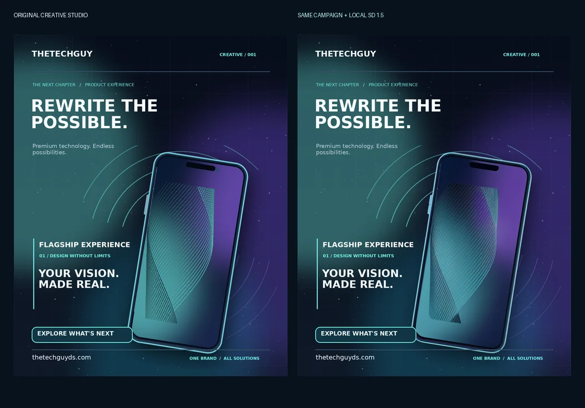

# Creative Studio — real ATHENA image generation comparison (17 October 2026)

**Left:** [Original Creative Studio flagship poster](../../../examples/campaigns/flagship/campaign.png), produced using the native editable Campaign Designer.
**Right:** [New AI-assisted poster render](flagship-ai-refined.png), composited using the same real Creative Studio layer renderer. The actual phone refinement is [a separate transparent image asset](phone-refined.webp).

## Controlled comparison

The original “REWRITE THE POSSIBLE” design is 1080 × 1350. The background, original image orbit, all editable text, typography, placement, CTA, labels and colors were retained. Only the **Replaceable hero product** raster layer was changed.

ATHENA ran a real ComfyUI inference with an NVIDIA RTX 4070 Laptop GPU, the installed Stable Diffusion 1.5 `v1-5-pruned-emaonly.safetensors` checkpoint and the original 700 × 1020 hero-phone illustration as image-to-image input. Settings: 512 × 768 inference, 28 sampling steps, Euler sampler, CFG 6.5, denoise 0.33, seed 20261018. ComfyUI job `62ea4a49-ef08-46bc-a960-11854f53745b` completed successfully.

The generated image was scaled back to the source-asset canvas and masked with the **original asset's transparency** to retain the exact silhouette. Native Creative Studio recomposition produced the right-hand poster. Rendering the unmodified baseline through that same renderer matched the committed original PNG pixel-for-pixel before substitution, establishing a controlled comparison.

A first text-only experiment at 512 × 640, 28 steps, seed 20261017, job `c3f5e214-9660-44a4-b7eb-49b95161f7a9`, was less faithful to the original phone shape and was not promoted as a finished poster.

**Visual assessment:** The image-to-image result preserves the phone much better than prompt-only generation and slightly alters its teal/violet highlights, but introduces softer screen detail. It is not clearly superior to the native original, and does not demonstrate that SD 1.5 is suitable for all premium advertising tasks. For product work, preserving editable typography and a separate generated product layer is preferable to asking diffusion to paint an entire poster.

**Storage:** No new checkpoint or ComfyUI runtime was installed, and no model binaries, duplicate installer archives or compilation caches are included in this proof branch. Only three small proof images are committed. No original campaign files were changed.
