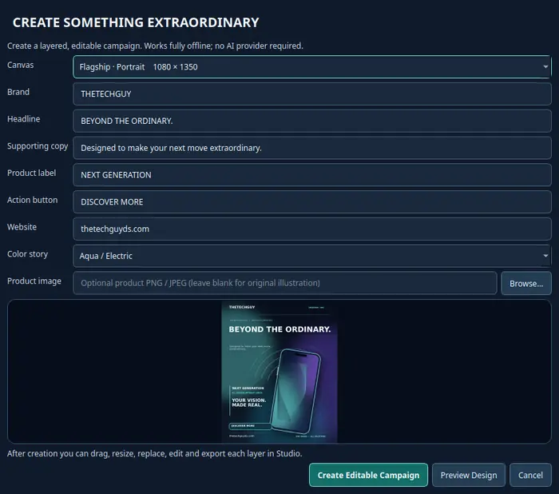
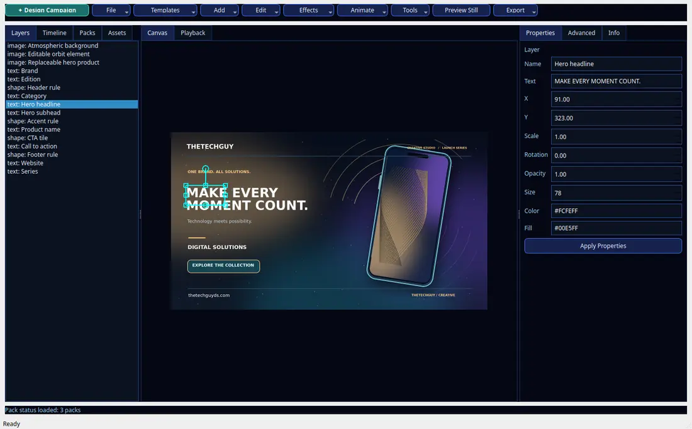

# TTG Creative Studio — Campaign Designer v1 visual and product review

**Review date:** 2026-10-15
**Repository:** `jaydumisuni/ttg-creative-studio` · Creative Studio PR #11
**Scope:** Native offline Campaign Designer, GUI/editor handoff, editable project
persistence and portable exports. This review does not cover Ptah infrastructure.

## Real application screenshots

These images were captured from the **running Qt application** in KRATOS's
isolated offscreen test environment, after opening a real campaign project.
They are not conceptual mockups.

## Three actual exported campaigns

These are committed Studio project/export pairs, not generative-AI claims.
Every sample has a `campaign.ttgstudio.json` document, relative image assets,
PNG render, SHA-256 manifest and portable ZIP.

| Layout | Artwork | Editable layers |
|---|---|---:|
| Portrait · 1080 × 1350 | [Flagship render](../../../examples/campaigns/flagship/campaign.png) | 18 |
| Square · 1080 × 1080 | [Social render](../../../examples/campaigns/social/campaign.png) | 15 |
| Widescreen · 1920 × 1080 | [Wide render](../../../examples/campaigns/wide/campaign.png) | 16 |

### Review findings and corrections

1. **Visible heading contrast:** The first captured campaign dialog inherited
   a light Qt background while the white title text was barely legible.
   The dialog now explicitly styles its dark background, field controls,
   menus, normal buttons, hover/focus outlines and primary CTA. A screenshot
   regression verifies the title appears against a dark background.
2. **Compact layout:** Earlier minimum canvas and toolbar dimensions could
   hide menu actions. The toolbar now scrolls while retaining menu width;
   the exact **Export** menu is tested for reachability in a constrained
   viewport, and the older canvas widget test confirms a 390 × 310 minimum.
3. **Typography:** Headline wrapping, subhead placement and system font
   fallbacks were inspected in portrait, square and widescreen exports.
   Keep the current artwork as examples, not templates for every brand.
4. **Editable, not flattened:** A real GUI Properties text edit survives
   Save/Reopen, visibly changes the exported pixels and works with Undo/Redo.
   Project assets resolve relative to each saved project. The bundle survives
   extraction into a different directory and reproduces the saved render.
5. **No external creative dependency:** All three campaigns use original
   procedural artwork and work offline without Hunter, Ptah or a cloud
   image-generation provider.

### Engineering verification

Use `python -B scripts/test_campaign_designer.py` and
`python -B scripts/verify_campaign_showcase.py` from the repo root. The
focused campaign suite reached **60 / 60** checks on KRATOS after the
contrast and editability additions. The existing full
`scripts/review_gate_all.py` passed after restoring the correct compact
canvas test. Windows and Linux CI must pass again on the **final pushed
commit** before this PR is advanced.

### Acceptance boundary

**Visual/product QA finding:** The current app presents a coherent, legible
offline campaign workflow and passes reproducible technical product checks.
This is **engineering review**, not user art-direction approval.

**Remain out of scope:** unrestricted AI text-to-image generation, full
professional photo retouching, final Windows signed installer, broader
motion-editor parity and owner/customer aesthetic acceptance.

**Decision:** Suitable to submit for the owner's final visual/product review
once exact-head CI is green. Keep PR #11 draft and unmerged until that decision.
No Ptah repository files, production services or infrastructure were changed.
